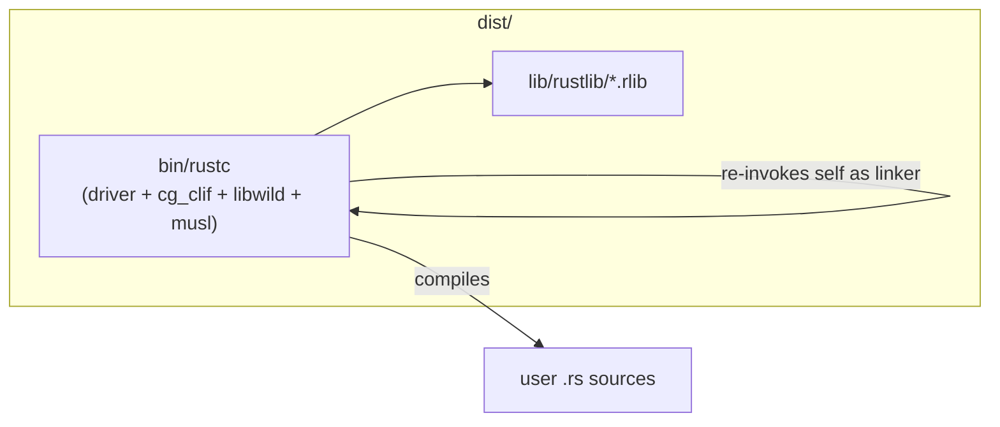

# lerustc

A build harness for a **dependency-free static `rustc`** toolchain on Linux x86_64:

- **Cranelift** codegen backend linked in statically (no LLVM, no `librustc_codegen_cranelift.so`)
- **musl** libc linked statically (fully static binary, no `libc.so` or dynamic linker)
- **Wild** embedded as a multicall linker (`rustc` re-invokes itself to link)
- **Sysroot** of standard-library `rlib`s alongside the compiler binary

The shipped artifact is roughly one ~150–250 MB `rustc` binary plus a `lib/rustlib/...` directory.

## Quick start

```bash
# Prerequisites: python3, git, curl, musl-tools, binutils (GNU `as`),
# and rustup with the stable toolchain for stage0 bootstrap.
sudo apt install musl-tools binutils

./build.sh all          # clone rust, patch, build, assemble dist/
./test/smoke.sh         # compile and run hello + threads test
```

## Layout

```
build.sh           # end-to-end build driver
bootstrap.toml     # copied to rust/config.toml during build
RUST_COMMIT        # pinned rust-lang/rust commit
patches/lerustc.patch
dist/
  bin/rustc        # single static multicall binary (musl)
  lib/rustlib/     # std rlibs for --sysroot
test/smoke.sh
```

## Usage

```bash
dist/bin/rustc --sysroot dist -o hello hello.rs
./hello
```

There is no `cargo` or `rustdoc` in this distribution — invoke `rustc` directly.

## Architecture



When linking, `rustc` sets `LERUSTC_AS_LINKER=1` and dispatches to embedded Wild instead of calling an external `ld`.

## Accepted limitations

| Limitation | Detail |
|---|---|
| **No custom proc macros** | A fully static binary cannot `dlopen` proc-macro dylibs. Built-in `#[derive(...)]` macros inside `rustc` still work. Crates using `serde_derive`, `thiserror`, `tokio::main`, etc. will not compile. |
| **Inline asm in user code** | cg_clif uses GNU `as` for inline assembly (`CG_CLIF_FORCE_GNU_AS=1`). Ensure `as` from binutils is on `PATH`. |
| **Platform** | Nightly-channel compiler, Linux x86_64 only. |
| **Build provenance** | Stage0 beta rustc (LLVM-based) compiles the artifact. The *artifact* contains no LLVM. |
| **Cranelift maturity** | Debug-oriented backend; slower generated code than LLVM. |

## Patches (against pinned `rust-lang/rust`)

1. **Static driver** — `rustc_driver` built as `rlib`, not `dylib`
2. **Builtin Cranelift** — `rustc_codegen_cranelift` registered in `rustc_interface` as a builtin backend
3. **Embedded Wild** — `libwild` multicall in `rustc-main`; default linker is `current_exe()`
4. **musl static** — `rustc-main` linked with `musl-gcc -static` and `+crt-static`

Set `LERUSTC=1` during bootstrap to activate patches (done automatically by `build.sh`).

The build cross-compiles in three phases: stage1 gnu compiler (bootstrap tool), musl `std`, then static musl-host `rustc` (installed as `stage2-rustc/.../rustc-main` in the build tree).

Override the musl linker with `LERUSTC_MUSL_LINKER=/path/to/musl-gcc` if needed.

## Stretch goals (not implemented)

- `x86_64-unknown-linux-musl` sysroot for fully static user binaries by default
- CI workflow with build caching
